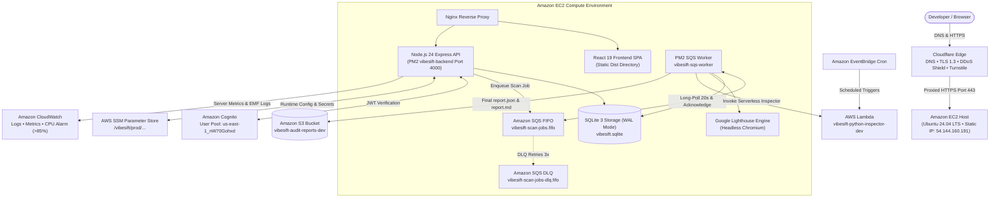
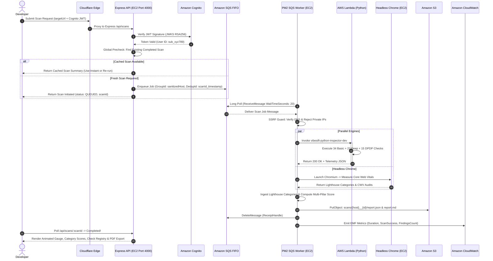

# 🌐 VibeSift Architecture, Terminology, User Flow & Backend Flow Guide

> **Official Systems Architecture, Engineering Trade-Offs & Evaluator Defense Playbook**  
> Covers the full journey of an audit request across the **7 Core AWS Services** (**Amazon S3**, **AWS Lambda**, **AWS SSM Parameter Store**, **Amazon Cognito**, **Amazon CloudWatch**, **Amazon EC2**, **Amazon SQS FIFO**), complete with technical definitions, architectural justifications, user flows, backend state machine, and 20 high-yield evaluation Q&As.

---

## 📑 Table of Contents
1. [Core Foundation: The 7 AWS Services](#1-core-foundation-the-7-aws-services)
2. [End-to-End User Flow (Step-by-Step Experience)](#2-end-to-end-user-flow-step-by-step-experience)
3. [Deep Backend Flow & State Machine](#3-deep-backend-flow--state-machine)
4. [Visual Architecture & Request Sequence (Mermaid Diagrams)](#4-visual-architecture--request-sequence-mermaid-diagrams)
5. [Component Dictionary: The 7 AWS Services & Infrastructure Primitives](#5-component-dictionary-the-7-aws-services--infrastructure-primitives)
6. [Deep Architectural Decisions & Engineering Trade-Offs](#6-deep-architectural-decisions--engineering-trade-offs)
7. [20 High-Yield Evaluator Q&As (Architecture, Security & Operations)](#7-20-high-yield-evaluator-qas)
8. [Verification & Test Commands Reference](#8-verification--test-commands-reference)

---

## 🏛️ 1. Core Foundation: The 7 AWS Services

VibeSift is engineered strictly on **7 core AWS services**, avoiding speculative microservices, bloated Kubernetes clusters, or redundant container orchestration:

| # | AWS Service | Primary Role in VibeSift | Key Configuration & Resource ID |
|---|---|---|---|
| **1** | **Amazon S3** | Durable, KMS-encrypted object storage for raw inspection telemetry, finalized `report.json`, executive `report.md`, and PDF downloads. | Bucket: `vibesift-audit-reports-dev-501380833083` (Prefixes: `scans/{host}__{id}/report.json`, `audits/`) |
| **2** | **AWS Lambda** | Event-driven serverless compute for the Python Website Inspector and scheduled EventBridge audit triggers. | Function: `vibesift-python-inspector-dev` (Python 3.12, 71 security & compliance checks, zip packaging) |
| **3** | **AWS Systems Manager (SSM) Parameter Store** | Centralized, encrypted runtime configuration, environment parameters, and secrets management without hardcoded files. | Path: `/vibesift/prod/...` (Encrypted SecureString parameters: Cognito IDs, S3 bucket names, SQS URLs) |
| **4** | **Amazon Cognito** | Enterprise user identity, developer registration, email verification, password hashing (SRP), and cryptographic RSA256 JWT issuance. | User Pool: `us-east-1_nW70Gohxd` (`vibesift-users-dev`), Client: `2o811dvh5f5n00r49540b9vav9` |
| **5** | **Amazon CloudWatch** | Real-time operational observability, host metrics (CPU/RAM), CloudWatch Logs, alarms (>85% CPU), and Embedded Metric Format (EMF). | Log Group: `/aws/lambda/vibesift-python-inspector-dev`, `/vibesift/host/api`, Host Alarm: `CPUUtilization-Alarm` |
| **6** | **Amazon EC2** | Turnkey Linux compute host running Nginx reverse proxy, Node.js 24 Express API (`vibesift-backend`), PM2 SQS worker (`vibesift-sqs-worker`), SQLite WAL mode, and Headless Chromium Lighthouse. | Instance: `vibesift-core-host-prod` (Ubuntu 24.04 LTS, Static Public IP: `54.144.160.191`) |
| **7** | **Amazon SQS FIFO** | Ordered, exactly-once deduplicated scan job queueing with Dead-Letter Queue (DLQ) for asynchronous, resilient job processing. | Queue: `vibesift-scan-jobs.fifo` (DLQ: `vibesift-scan-jobs-dlq.fifo`, 20s long-polling, 300s visibility timeout, maxReceiveCount=3) |

*(Backed at the perimeter by **Cloudflare Edge** for global Anycast DNS, SSL/TLS 1.3 termination, Turnstile human verification, and Layer 7 DDoS mitigation).*

---

## 🚶 2. End-to-End User Flow (Step-by-Step Experience)

How a developer experiences VibeSift from landing on the website to applying production code fixes:

```
[Phase 1: Ingress & Discovery]
  User arrives at https://vibesift.pixir.in -> Served by Cloudflare Edge & Nginx (React 19 SPA)
  User signs up or logs in -> Authenticated via Amazon Cognito (stores JWT in session)
       │
       ▼
[Phase 2: URL Submission & Scope Selection]
  User inputs target URL (e.g., https://example.com)
  User chooses Scope:
    • Baseline Public: Non-intrusive hygiene, SEO, performance, passive DPDP check (instant, no setup)
    • Authorized Deep: Active security probes, XSS/SQLi resilience, cookie audit (requires domain verification)
       │
       ▼
[Phase 3: Domain Verification (If Authorized Deep Chosen)]
  System generates a cryptographic verification challenge token: vibesift-verify=<token>
  User chooses verification method: DNS TXT record (@ or _vibesift) OR HTML <meta> tag
  Backend verifies ownership live via DNS query or HTTP fetch before deep scan is unlocked
       │
       ▼
[Phase 4: Instant Precheck / SQS FIFO Enqueue]
  System executes instant precheck across database and S3 for existing valid audits for the hostname:
    • Cached report found: UI prompts "Existing audit found! View instant cached report or re-run fresh."
    • Fresh audit requested: Express dispatches job to Amazon SQS FIFO (vibesift-scan-jobs.fifo)
       │
       ▼
[Phase 5: Background Processing & Real-Time Feedback]
  EC2 PM2 Worker (vibesift-sqs-worker) pulls message via 20s long-polling
  Frontend displays live state machine progress: VALIDATING ➔ RUNNING ➔ NORMALIZING
  Engines execute in parallel (AWS Lambda Python Inspector + EC2 Headless Chromium)
       │
       ▼
[Phase 6: Actionable Report & Code Remediation]
  Frontend receives completed scan result:
    • Launch Readiness Score (0–100) animated SVG gauge
    • 11 Operational Category breakdown cards (Security, Performance, SEO, DPDP Compliance, etc.)
    • Prioritized Findings cards with observed server evidence & exact line fixes
    • Framework-specific code fixes (Next.js, Vite, Tailwind, Nginx)
    • 1-Click Export: Secure presigned S3 downloads for JSON, Markdown, and PDF
```

---

## ⚙️ 3. Deep Backend Flow & State Machine

The backend request lifecycle follows a strict, deterministic sequence to guarantee security, fault isolation, and data durability:

```
┌────────────────────────────────────────────────────────────────────────────────────────┐
│                               BACKEND PIPELINE STATE MACHINE                           │
├────────────────────────────────────────────────────────────────────────────────────────┤
│                                                                                        │
│  [1. INGRESS & COGNITO JWT AUTH]                                                       │
│      • Express auth middleware extracts 'Authorization: Bearer <token>'                │
│      • Validates RSA256 signature against Amazon Cognito JWKS endpoint                 │
│      • Verifies issuer, expiration (exp), and extracts Cognito UUID (sub)              │
│                                                                                        │
│  [2. RUNTIME CONFIG VIA AWS SSM PARAMETER STORE]                                       │
│      • Fetches environment parameters and secrets from /vibesift/prod/                 │
│      • Injects KMS-decrypted secrets (S3 bucket, Cognito keys, SQS URLs)               │
│                                                                                        │
│  [3. SSRF DEFENSE MATRIX & DNS VERIFICATION]                                           │
│      • Normalizes target URL; restricts scheme to http/https and ports to 80/443       │
│      • Resolves destination host via DNS (all A/AAAA records)                          │
│      • BLOCKS: 127.0.0.1, RFC 1918 private subnets (10.0.0.0/8, 192.168.0.0/16),    │
│        and AWS Cloud Metadata (169.254.169.254)                                        │
│                                                                                        │
│  [4. GLOBAL CACHE DISCOVERY & SQS FIFO DISPATCH]                                       │
│      • Precheck looks up latest completed scan across tenants & S3 report bucket       │
│      • If cached scan requested: returns existing audit instantly                      │
│      • If fresh scan: inserts scan record (status: QUEUED) and sends message to SQS    │
│        FIFO queue with MessageGroupId (hostname) and deduplication ID                  │
│                                                                                        │
│  [5. EC2 SQS WORKER CONSUMPTION & PARALLEL EXECUTION]                                  │
│      • PM2 process 'vibesift-sqs-worker' polls SQS with 20s long-polling               │
│      • Transitions state: QUEUED ➔ VALIDATING ➔ RUNNING                                │
│      ├─ Worker A: AWS Lambda (vibesift-python-inspector-dev)                           │
│      │    - Runs 34 Basic checks (headers, SSL/TLS, SEO, sitemap)                      │
│      │    - Runs 22 Deep security tests (XSS, SQLi errors, CORS, framing)              │
│      │    - Runs 15 Privacy checks (DPDP Act 2023, consent parity, grievance officer)  │
│      │                                                                                 │
│      └─ Worker B: EC2 Native Chromium Lighthouse                                       │
│           - Headless Chromium collects Core Web Vitals (LCP, CLS, FCP, TBT)            │
│           - Evaluates DOM accessibility tree, responsive layout, performance audits    │
│                                                                                        │
│  [6. NORMALIZATION, LIGHTHOUSE INGESTION & WEIGHTED SCORING]                           │
│      • Normalizes findings and converts Core Web Vitals into Check Registry entries    │
│      • Ingests genuine Lighthouse scores for performance, accessibility, seo, best-pra │
│      • Calculates Launch Readiness Score (0-100) via multi-pillar weighted formula:    │
│        Security 25%, Performance 20%, Accessibility 15%, SEO 15%,                      │
│        Privacy 15%, Completeness & Trust 10% (capped at 50 if Critical defects exist)  │
│      • Generates deterministic developer guidance & executive summary                  │
│                                                                                        │
│  [7. S3 PERSISTENCE, SQS ACKNOWLEDGEMENT & CLOUDWATCH METRICS]                         │
│      • Writes finalized scans/{host}__{id}/report.json and report.md to Amazon S3      │
│      • Deletes message from SQS FIFO queue upon successful processing                  │
│      • Transitions state: NORMALIZING ➔ COMPLETED                                      │
│      • Emits CloudWatch Embedded Metric Format (EMF) record for latency and errors     │
│                                                                                        │
└────────────────────────────────────────────────────────────────────────────────────────┘
```

---

## 📊 4. Visual Architecture & Request Sequence (Mermaid Diagrams)

### 4.1 Cloud Architecture Topology


### 4.2 Sequence Diagram: Full Request & Worker Execution


---

## 📖 5. Component Dictionary: The 7 AWS Services & Infrastructure Primitives

### 1. Amazon S3 (Simple Storage Service)
- **Role:** High-durability (99.999999999%) cloud object storage for heavy, immutable audit artifacts.
- **Why we use it:** Storing full Lighthouse traces (1MB–5MB) and raw Python engine dumps directly inside a database causes rapid database bloat. S3 keeps database rows lightweight while storing immutable JSON and Markdown reports.
- **Key Capability:** **Presigned URLs (`@aws-sdk/s3-request-presigner`)** allow authenticated developers to download PDF and Markdown reports securely via time-limited (15-minute) signed links directly from S3 without streaming heavy payloads through the Node API.

### 2. AWS Lambda (Serverless Compute)
- **Role:** On-demand, event-driven serverless worker executing the Python Website Inspector and scheduled EventBridge triggers.
- **Why we use it:** The Python inspector runs 71 distinct security, DPDP compliance, and infrastructure checks. Spawning dozens of concurrent deep crawlers on an EC2 host could exhaust CPU. Lambda isolates each audit in an ephemeral container with zero idle cost.
- **Fault-Tolerant Fallback:** If Lambda is unreachable or offline, the API automatically catches the error and executes the local Python inspector process seamlessly.

### 3. AWS Systems Manager (SSM) Parameter Store
- **Role:** Secure, centralized configuration management and secrets store.
- **Why we use it:** Storing database credentials, Cognito client IDs, and S3 bucket names in committed `.env` files creates serious credential leakage risks. SSM Parameter Store allows parameters under `/vibesift/prod/` to be encrypted at rest with AWS KMS and loaded into application memory at boot time.
- **Key Capability:** Free-tier standard parameters provide zero-cost secret storage with automatic SDK fallback to `process.env`.

### 4. Amazon Cognito
- **Role:** Fully managed customer identity and access management (CIAM).
- **Why we use it:** Handles developer registration, email confirmation codes, password salting and hashing (Secure Remote Password protocol), and MFA without storing plaintext passwords in application databases.
- **Stateless Verification:** Issues RSA256-signed JSON Web Tokens (JWT). The API validates tokens in sub-milliseconds against Cognito's public JSON Web Key Set (JWKS) without repeated database queries.

### 5. Amazon CloudWatch
- **Role:** Complete operational observability, real-time logging, alarms, and performance metrics.
- **Why we use it:** Monitors host health (CPU, memory, disk I/O) and serverless Lambda executions. CloudWatch Alarms notify engineers if host CPU exceeds 85% for 10 minutes.
- **Key Capability:** **Embedded Metric Format (EMF)** allows the backend to output structured JSON logs containing custom metrics (`ScanDuration`, `ScoreCalculated`, `EngineErrorCount`) that CloudWatch automatically indexes into real-time metric charts with zero extra agent overhead.

### 6. Amazon EC2
- **Role:** Core Linux compute environment hosting Nginx, the Express API (`vibesift-backend`), PM2 SQS worker (`vibesift-sqs-worker`), SQLite, and Chromium.
- **Why we use it:** Headless Chromium requires native Linux OS binaries and shared libraries (`libnss3`, `libatk`, `libxss`). Running Chromium in Lambda requires complex 250MB layers and suffers from 8–15s cold starts. EC2 launches Chromium in under 100ms.
- **Reliability:** Managed under PM2 process supervisor with automatic restart on unexpected exceptions.

### 7. Amazon SQS FIFO Queue
- **Role:** Decoupled, exactly-once asynchronous scan job queue (`vibesift-scan-jobs.fifo`) backed by a Dead-Letter Queue (`vibesift-scan-jobs-dlq.fifo`).
- **Why we use it:** Decouples user-facing HTTP request ingress from long-running (15–45s) audit pipelines. Prevents EC2 CPU spikes during traffic surges by buffering incoming requests.
- **Key Capability:** FIFO guarantees strict per-host ordered processing using `MessageGroupId` and eliminates duplicate audit submissions within 5 minutes via `MessageDeduplicationId`.

### 8. Cloudflare Edge Perimeter
- **Role:** Anycast reverse proxy front door (`vibesift.pixir.in`).
- **Why we use it:** Terminates TLS 1.3, caches static Vite bundles worldwide for sub-20ms initial loads, mitigates volumetric DDoS attacks, and validates Cloudflare Turnstile human tokens.

### 9. SSRF Guard (Zero-Trust Validation)
- **Role:** Outbound request verification defense module (`backend/src/services/ssrfGuard.js`).
- **Why we use it:** Protects against Server-Side Request Forgery attacks. Resolves target hostnames before sending any HTTP request and blocks connections to loopback (`127.0.0.1`), RFC 1918 private subnets (`10.0.0.0/8`, `192.168.0.0/16`), and AWS Instance Metadata Service (`169.254.169.254`).

### 10. SQLite 3 in WAL Mode
- **Role:** Embedded high-throughput relational database (`vibesift.sqlite`) compiled natively into Node.js (`node:sqlite`).
- **Why we use it:** Delivers sub-millisecond (0.1ms) queries for scan status, user site ownership, and dashboard history without network roundtrips. Write-Ahead Logging (WAL) mode enables concurrent dashboard readers while background workers record audit findings simultaneously.

---

## ⚖️ 6. Deep Architectural Decisions & Engineering Trade-Offs

### 1. Why EC2 + Lambda Over ECS Fargate Containers?
- **Fargate Overhead:** Running ECS Fargate tasks requires AWS NAT Gateways (~$32/mo per AZ), ECR container image repositories, and adds 30–45 seconds of container pull latency per scan.
- **Our Solution:** A lean EC2 instance runs the API and Chromium instantly (<100ms startup), while AWS Lambda handles the Python Inspector. Zero NAT Gateway cost, zero cold-start delay for API endpoints.

### 2. Why Amazon SQS FIFO Over Synchronous Execution or AWS Step Functions?
- **Step Functions / Fargate Cost:** Step Functions state transitions incur per-transition charges and require complex state machine definitions. Synchronous HTTP execution risks 504 Gateway Timeouts on deep scans.
- **Our Solution:** Amazon SQS FIFO provides 20-second long-polling with near-zero AWS cost, message deduplication by host, automatic retry, and routes poison messages to a DLQ after 3 failed attempts without dropping requests.

### 3. Why Two-Tier Storage (SQLite + Amazon S3)?
- **Database Bloat Prevention:** Storing multi-megabyte Lighthouse traces and raw HTML dumps in a database quickly causes disk thrashing and slow dashboard queries.
- **Our Solution:** SQLite stores lightweight relational rows (`scanId`, `targetUrl`, `status`, `readinessScore`), while Amazon S3 stores permanent audit dumps (`report.json`, `report.md`).

### 4. Why AWS SSM Parameter Store Over Hardcoded Environment Files?
- **Security Best Practice:** Storing production API keys and bucket names in local files poses severe risks during team scaling or accidental Git commits.
- **Our Solution:** The backend loads parameters dynamically from AWS SSM Parameter Store with KMS encryption, keeping code completely decoupled from runtime secrets.

### 5. Why Deterministic Rules-Based Explanations Over External LLM APIs?
- **LLM Fragility & Latency:** External LLMs (e.g., Bedrock Claude, OpenAI) add 3–8 seconds of latency, incur recurring token costs, and risk hallucinating invalid security recommendations or leaking user URLs.
- **Our Solution:** `DeterministicExplanationService` delivers instantaneous, reproducible, rule-mapped remediation snippets tailored directly to the detected issue with 0 external API cost.

---

## 🎯 7. 20 High-Yield Evaluator Q&As

### Q1: When a developer clicks "Run Audit", what is the first thing that happens?
**Answer:** The React 19 frontend validates the target URL format, retrieves the developer's Cognito JWT ID token from session storage, and submits an HTTP `POST /api/scans` request with `Authorization: Bearer <token>`.

### Q2: How does VibeSift verify user authentication?
**Answer:** Through **Amazon Cognito JWT verification**. The Express auth middleware verifies the token's RSA256 signature against the Cognito User Pool's public JWKS endpoint, validates expiration and audience, and attaches the verified user UUID (`sub`) to `req.user`.

### Q3: What is SSRF and how does VibeSift prevent it?
**Answer:** Server-Side Request Forgery is an attack where a user inputs internal addresses to trick our server into accessing private networks. VibeSift's `ssrfGuard.js` normalizes the URL, resolves its DNS records, and strictly terminates connections to localhost (`127.0.0.1`), RFC 1918 private subnets (`10.0.0.0/8`, `192.168.0.0/16`), and AWS Cloud Metadata (`169.254.169.254`).

### Q4: What are the 7 core AWS services used in VibeSift?
**Answer:**
1. **Amazon S3:** Raw telemetry and report storage.
2. **AWS Lambda:** Serverless Python Inspector and scheduled triggers.
3. **AWS Systems Manager (SSM) Parameter Store:** Centralized runtime secrets and configuration.
4. **Amazon Cognito:** User authentication and JWT verification.
5. **Amazon CloudWatch:** Server metrics, EMF logs, and CPU alarms.
6. **Amazon EC2:** Host compute for API, SQLite, and Headless Chromium Lighthouse.
7. **Amazon SQS FIFO:** Ordered asynchronous queueing with Dead-Letter Queue.

### Q5: Why is AWS SSM Parameter Store used instead of plain .env files?
**Answer:** SSM Parameter Store provides centralized, encrypted secret storage with AWS KMS. It eliminates plaintext credentials from server disks, enables dynamic configuration updates without redeploying code, and enforces IAM role-based access.

### Q6: How does Amazon CloudWatch monitor VibeSift?
**Answer:** CloudWatch tracks host CPU utilization, memory, and instance status check alarms (>85% CPU threshold). Additionally, the backend emits CloudWatch Embedded Metric Format (EMF) logs, enabling automated custom metric generation for scan latency and failure rates.

### Q7: Why is Cloudflare placed in front of AWS EC2?
**Answer:** Cloudflare acts as an edge perimeter shield. It provides global Anycast DNS, terminates TLS 1.3, caches static frontend assets across 300+ edge locations for sub-20ms delivery, and absorbs DDoS traffic before it reaches AWS.

### Q8: What are the 3 audit suites in the Python Inspector Lambda?
**Answer:**
1. **BasicAuditor (34 checks):** Security headers, SSL/TLS handshake quality, SEO metadata, sitemaps, robots.txt.
2. **DeepAuditor (22 checks):** Active security tests including XSS reflection, SQLi error handling, CSP rules, and CORS misconfigurations.
3. **PrivacyAuditor (15 checks):** Indian DPDP Act 2023 compliance, cookie consent banner parity, and Grievance Officer disclosures.

### Q9: What happens if the AWS Lambda invocation fails or is offline?
**Answer:** VibeSift implements a **graceful fallback mechanism** in `workflowHandler.js`. If the Lambda client encounters an exception or credentials are unavailable, the backend automatically invokes the local Python inspector process, ensuring continuous operation.

### Q10: What are Core Web Vitals (CWV) and how are they measured?
**Answer:** Core Web Vitals are Google's metrics for real-world user experience: Largest Contentful Paint (LCP < 2.5s), Cumulative Layout Shift (CLS < 0.1), First Contentful Paint (FCP < 1.8s), and Total Blocking Time (TBT < 200ms). VibeSift runs Google Lighthouse in headless Chromium on EC2 to measure these metrics directly from the DOM and maps them directly into the audit check registry.

### Q11: Why do we use SQLite and Amazon S3 together instead of just one database?
**Answer:** SQLite is an embedded relational database optimized for fast, indexed queries on small tabular rows (scan status, findings, user ownership). Amazon S3 is an object store optimized for heavy, multi-megabyte unstructured files (raw engine JSON dumps, markdown reports). Keeping heavy blobs out of SQLite prevents database bloat and preserves sub-millisecond query performance.

### Q12: What is SQLite WAL mode?
**Answer:** Write-Ahead Logging (WAL). In WAL mode, new writes are appended sequentially to a separate `-wal` file while reads continue simultaneously from the main database file without blocking. This allows concurrent readers to query scan progress while workers record findings.

### Q13: How does VibeSift balance multi-tenant user isolation with cross-tenant caching?
**Answer:** Every audit record in `scans` and `findings` is isolated by `ownerUserId` (Cognito `sub`) so users can only view or manage their own private scan histories. However, during precheck (`POST /scans/precheck` and `POST /scans` `useCached: true`), the platform checks globally for existing completed audits of the requested hostname across the database and S3. This allows User B to instantly reuse a fresh audit run by User A, eliminating redundant scans while keeping scan records strictly isolated.

### Q14: What is the difference between Baseline Public Scan and Authorized Deep Scan?
**Answer:**
- **Baseline Public Scan:** Non-intrusive evaluation (completeness, SEO, basic headers, passive privacy). Runs on any public URL without setup.
- **Authorized Deep Scan:** Active security probing (XSS reflection tests, SQL injection tests, path traversal, active cookie manipulation). Strictly requires verified domain ownership to prevent unauthorized penetration testing.

### Q15: How does domain ownership verification work?
**Answer:** When adding a domain for deep audits, VibeSift generates a cryptographic challenge token (e.g., `vibesift-site-verification=abc123...`). The user verifies control by:
1. Adding a DNS TXT record at `@` or `_vibesift`.
2. Placing an HTML `<meta name="vibesift-verification">` tag in their homepage `<head>`.
3. Serving a verification file at `/.well-known/vibesift-verification.txt`.

### Q16: How does the frontend update scan progress in real time?
**Answer:** The frontend uses TanStack Query with an exponential backoff polling strategy. While the scan state is `QUEUED`, `VALIDATING`, or `RUNNING`, the UI polls `GET /api/scans/:scanId` every 1.5 seconds. Once the status transitions to `COMPLETED` or `FAILED`, polling terminates and the finalized report renders.

### Q17: How does a user download an audit report securely from S3?
**Answer:** Through **Amazon S3 Presigned URLs**. The API verifies the user's ownership of the scan, then requests a time-limited signed URL (`getSignedUrl` with 15-minute TTL). The user's browser downloads the report directly from S3 without burdening the API server.

### Q18: What is the Launch Readiness Score and how is it calculated?
**Answer:** A 0–100 weighted index evaluating whether a website is ready for production traffic across 6 core pillars:
- **Security Posture (25% weight):** SSL/TLS, CSP, HSTS, cookie flags, XSS/SQLi resilience.
- **Performance & Core Web Vitals (20% weight):** Directly derived from genuine Lighthouse CWV metrics.
- **Accessibility (15% weight):** Contrast, form labels, ARIA landmarks, image alt attributes.
- **SEO (15% weight):** Meta titles, descriptions, canonical tags, robots.txt, sitemaps.
- **Privacy & DPDP Compliance (15% weight):** Consent parity, grievance officer disclosure, tracking controls.
- **Completeness & Trust (10% weight):** 404 handling, legal policies, RFC 9116 `security.txt`.
*Safety Rule:* If an unpatched Critical security defect exists, the overall Launch Readiness Score is hard-capped at 50/100 to prevent premature deployment.

### Q19: What is the Dead-Letter Queue (DLQ) in SQS and how does it protect the platform?
**Answer:** If a scan job encounters unexpected runtime crashes or unhandled exceptions, the SQS visibility timeout expires and the message reappears. If it fails 3 consecutive times (`maxReceiveCount = 3`), SQS automatically shifts the poison message into `vibesift-scan-jobs-dlq.fifo`. This isolates faulty payloads, prevents infinite crash loops, and triggers a CloudWatch alert for engineering review.

### Q20: What are CloudWatch Embedded Metric Format (EMF) logs?
**Answer:** EMF is a standardized JSON schema allowing applications to emit custom metrics directly into CloudWatch Logs. CloudWatch automatically extracts and indexes the embedded metrics without requiring custom API calls or third-party metric collectors.

---

## 🧪 8. Verification & Test Commands Reference

All test suites verify system stability and contract compliance across both cloud and local modes:

```bash
# 1. Run all Backend API tests (73 tests passing)
cd backend && npm test

# 2. Run all Frontend Vitest component & smoke tests (52 tests passing)
npm test -- --run

# 3. Run all Python Inspector & Lambda unit tests (6 tests passing)
python backend/src/workers/python-inspector/test_inspector.py
python backend/src/workers/python-inspector/test_lambda.py

# 4. Trigger the serverless AWS Lambda Python Inspector locally
npm run demo:lambda

# 5. Real-time inspection dashboard for Cognito, SQLite & Amazon S3
npm run demo:inspect
```
