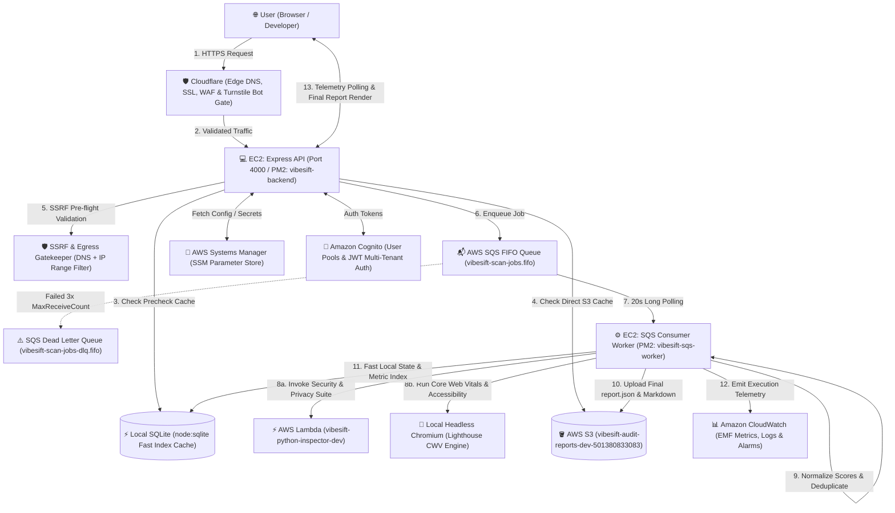

# VibeSift Production Architecture & AWS Operations Runbook

This document is the single authoritative architectural reference and operations manual for the **VibeSift** website auditing, security verification, and performance analysis platform. It details every technology actively used in the system, the end-to-end user lifecycle, CLI commands, AWS Console monitoring steps, real-world mental models, and engineering trade-offs.

---

## 1. High-Level Architecture Topology



---

## 2. End-to-End User Flow & Execution Lifecycle

### Phase 1: Initiation & Gatekeeping
1. **User Submission**: The developer visits the VibeSift interface and inputs a website URL (e.g., `https://example.com`) and chooses a scan profile (`baseline_public` or `authorized_deep`).
2. **Cloudflare Edge Validation**: The request passes through Cloudflare. Cloudflare Turnstile validates that the submitter is human without requiring intrusive visual puzzles. Cloudflare WAF drops known scrapers, volumetric Layer 7 attacks, and malicious bot traffic.
3. **Cognito Token Verification**: The Express API receives the request with an `Authorization: Bearer <JWT>` header (or secure session). The API verifies the JWT against Amazon Cognito’s JWKS key set to identify the user (`ownerUserId`).
4. **Global S3 & SQLite Precheck (Cache Discovery)**:
   - Before consuming SQS or cloud compute, the API calls `POST /api/scans/precheck`.
   - The backend checks whether a completed audit for `example.com` already exists in SQLite or Amazon S3 (`scans/example_com__<scanId>/report.json`).
   - If found, the frontend pops up the **Existing Audit Modal**: *"Existing Audit Found in S3 — This website has already been audited [View Existing Audit] [Re-Audit Now]"*.
   - If the user chooses to view existing, they immediately see the cached report with zero delay or cost.

### Phase 2: SSRF & Ingestion
5. **SSRF Guard & IP Egress Gatekeeper**: If a fresh audit is required, the URL is normalized. DNS resolution is performed to inspect target IP addresses:
   - **Blocked**: Loopback (`127.0.0.1`, `::1`), Private RFC 1918 subnets (`10.0.0.0/8`, `172.16.0.0/12`, `192.168.0.0/16`), Link-Local (`169.254.0.0/16`), and AWS Instance Metadata Service (`169.254.169.254` IMDSv1/IMDSv2).
   - If illegal or private, the scan rejects immediately with `SSRF_BLOCKED` before network egress occurs.
6. **SQS FIFO Dispatch**: A new `scanId` (`scn_<hex>`) is created. The job is placed on the AWS SQS FIFO Queue:
   - `MessageGroupId`: `sanitizeTargetHost(hostname)` (Domain-level serialization ensures domain safety).
   - `MessageDeduplicationId`: `${scanId}_${Date.now()}`.
   - Scan status is recorded as `QUEUED` in SQLite.

### Phase 3: Background Worker Execution
7. **SQS Long Polling**: The EC2 PM2 worker process (`vibesift-sqs-worker`) executes continuous 20-second long polling on SQS FIFO (`ReceiveMessageCommand`).
8. **Pipeline Transition (`VALIDATING` → `RUNNING`)**:
   - The worker claims the message; SQS hides the message from other workers via the 180-second `VisibilityTimeout`.
   - The scan state updates to `RUNNING`.
9. **Dual Engine Orchestration**:
   - **Engine 1 (Security & Privacy via AWS Lambda)**: The worker invokes AWS Lambda function `vibesift-python-inspector-dev`. The function runs Python-based `BasicAuditor` (34 quality & trust checks), `DeepAuditor` (22 active security tests: SQLi, XSS, HSTS, CSP, framing, CORS, sensitive files), and `PrivacyAuditor` (15 Indian DPDP Act 2023 checks).
   - **Engine 2 (Performance & Core Web Vitals via Local Chromium)**: The worker spawns Google Lighthouse inside local headless Chromium (`--headless --no-sandbox --disable-dev-shm-usage`). Lighthouse collects raw Core Web Vitals: Largest Contentful Paint (LCP), First Contentful Paint (FCP), Cumulative Layout Shift (CLS), Total Blocking Time (TBT), and Speed Index.

### Phase 4: Normalization & Delivery
10. **Normalization & Scoring Engine (`NORMALIZING`)**:
    - The engine ingests both Python results and Lighthouse Result (LHR).
    - It extracts genuine Lighthouse category scores for `performance`, `accessibility`, `seo`, and `best-practices`.
    - It maps Core Web Vitals and Lighthouse audits into structured `AuditCheckResult` checks, populating the check registry.
    - It computes Launch Readiness Score (0–100) using multi-pillar weights (Security 25%, Performance 20%, Accessibility 15%, SEO 15%, Privacy 15%, Completeness/Trust 10%).
11. **Persistence & Archival**:
    - Generates full `report.json` and executive `report.md`.
    - Uploads both to Amazon S3: `scans/<sanitizedHost>__<scanId>/report.json` with KMS encryption.
    - Saves the structured report, findings, and checks into SQLite (`.local_storage/vibesift.sqlite`).
    - The worker deletes the processed job from SQS FIFO (`DeleteMessageCommand`).
    - CloudWatch Embedded Metric Format (EMF) logs execution time and final readiness scores.
12. **Frontend UI Telemetry & Render**:
    - The frontend polling loop receives status `COMPLETED`.
    - The UI renders the **Interactive Audit Report**: Score Gauges, Severity Distribution Bars, Findings Tabs with AI Remediation snippets, and the Full Check Registry.

---

## 3. Technology Breakdown

---

### Component 1: Cloudflare (DNS, SSL, WAF & Turnstile)

#### What is it?
Cloudflare is an Edge Network and Content Delivery Network (CDN) that sits between the public internet and our EC2 host, providing reverse-proxy caching, DDoS mitigation, and bot management.

#### Why are we using it?
* **Origin Shielding**: Hides the real IP address of our EC2 instance (`ip-172-31-31-105`) from attackers.
* **SSL/TLS Termination**: Provides modern TLS 1.3 certificates and terminates HTTPS at the edge.
* **Bot Defense (Turnstile)**: Protects the `POST /api/scans` submission endpoint from automated bots and scraper loops without forcing users to solve Captcha puzzles.

#### Where are we using it?
* **DNS Records**: Proxied A/CNAME records pointing `vibesift.pixir.in` to our EC2 Elastic IP.
* **Turnstile Integration**:
  - Frontend: `src/components/common/SiteUrlForm.tsx` renders Turnstile verification.
  - Backend: `backend/src/api/middleware/turnstile.js` validates `cf-turnstile-response` token with Cloudflare's `https://challenges.cloudflare.com/turnstile/v0/siteverify`.

#### Real-World Analogy
Cloudflare is like a security guard station at the front gate of a high-security office park. Visitors are checked for weapons (DDoS/WAF) and badges (Turnstile) before ever reaching the office building (EC2).

#### Why choose it over alternatives (e.g., AWS CloudFront + AWS WAF)?
| Feature | Cloudflare (Current) | AWS CloudFront + AWS WAF |
| :--- | :--- | :--- |
| **Turnstile Bot Defense** | Built-in, free, seamless | Requires AWS WAF Captcha ($10/mo + $1/1K puzzles) |
| **Cost** | Free Tier covers DNS, SSL & CDN | Minimum $5/rule/mo + request billing |
| **Setup Overhead** | 2-minute nameserver switch | Requires ACM certs, ALB setup, CloudFront distribution |

#### CLI Commands to Inspect
```bash
# Verify Cloudflare Edge headers, HTTP/2, and proxy status
curl -I https://vibesift.pixir.in

# Look for Cloudflare headers in response:
# cf-ray: ...
# server: cloudflare
# cf-cache-status: DYNAMIC
```

#### Steps in Cloudflare Web Console
1. Log in to [dash.cloudflare.com](https://dash.cloudflare.com).
2. Click domain **pixir.in** or **vibesift.pixir.in**.
3. Under **Security → Events**, view real-time blocked requests, bot scores, and WAF flags.
4. Under **Turnstile**, verify widget status, visitor solve rate, and rejected token percentages.

---

### Component 2: Amazon EC2 (Virtual Compute & PM2 Workers)

#### What is it?
Amazon Elastic Compute Cloud (EC2) is a resizable virtual server running Ubuntu Linux in the `us-east-1` region, hosting our Node.js runtime and background worker processes.

#### Why are we using it?
* **Full Process Control**: Allows running persistent PM2 daemons (`vibesift-backend` and `vibesift-sqs-worker`).
* **Headless Chromium Execution**: Running real Google Lighthouse audits requires a native Chromium environment with Linux sandbox permissions, which is difficult and expensive to run on ephemeral Lambda functions due to binary size (200MB+) and execution timeout limits.
* **Fast Local State**: Hosts native `node:sqlite` for sub-millisecond local indexing.

#### Where are we using it?
* Instance ID: Private IP `172.31.31.105` (Region: `us-east-1`).
* Filesystem: `/var/www/vibesift`.
* Process 0 (`vibesift-backend`): `backend/src/local-dev/server.js` (Express REST API on port 4000, reversed proxied via NGINX).
* Process 1 (`vibesift-sqs-worker`): `backend/src/orchestration/sqsConsumer.js` (SQS FIFO long-polling consumer).

#### Real-World Analogy
EC2 is your dedicated workshop workbench. It has all the specialized heavy tools (Chromium, PM2, local disk database) permanently installed and ready to work without needing to be unpacked on every job.

#### Why choose it over alternatives (e.g., AWS App Runner, ECS Fargate, Lightsail)?
* **vs. ECS Fargate**: Fargate has high cold-start times (15–30s to boot containers for a single scan) and charges for memory per second. Running Headless Chrome on Fargate can double AWS bills.
* **vs. AWS Lightsail**: Lightsail does not support fine-grained IAM Instance Profiles, meaning you must hardcode AWS API keys in plain text files.
* **EC2 Advantage**: Attached to an IAM Instance Profile (temporary STS role credentials), PM2 auto-restart on memory leak, and instant execution.

#### CLI Commands to Inspect & Manage
```bash
# SSH into EC2 instance
ssh -i vibesift-key.pem ubuntu@<EC2_PUBLIC_IP>

# Inspect running processes
pm2 status

# Real-time streaming logs for API
pm2 logs vibesift-backend --lines 50

# Real-time streaming logs for SQS Worker
pm2 logs vibesift-sqs-worker --lines 50

# Restart both processes with fresh environment variables
pm2 restart all --update-env

# Check EC2 system memory and disk utilization
htop
df -h
```

#### Steps in AWS Web Console
1. Navigate to **EC2 Console** (`us-east-1`).
2. Click **Instances** → Select your VibeSift instance.
3. Under the **Monitoring** tab, observe CPU Utilization, Network In/Out, and Status Checks (2/2 passed).
4. Click **Actions → Security → Modify IAM Role** to verify that the EC2 Instance Profile has permissions for SQS, S3, Lambda, and SSM.

---

### Component 3: Amazon Cognito (User Directory & Auth)

#### What is it?
Amazon Cognito provides customer identity and user pool management, supporting sign-up, email verification, password management, and OpenID Connect (OIDC) JWT issuance.

#### Why are we using it?
* **Multi-Tenant User Isolation**: Every scan and saved site is partitioned by `ownerUserId` (Cognito `sub` claim), ensuring User B cannot tamper with or delete User A's data.
* **Secure JWT Validation**: Express verifies RS256 JWT tokens using Cognito's public JWKS keys without making round-trip network calls to verify sessions.

#### Where are we using it?
* Backend: `backend/src/api/middleware/auth.js` validates JWT `id_token` and `access_token`.
* User Pool ID: Referenced in `backend/src/config/env.js` and SSM Parameter `/vibesift/dev/cognito/user-pool-id`.
* Client ID: Referenced in frontend auth context (`src/context/AuthContext.tsx`).

#### Real-World Analogy
Cognito is like a passport office. It verifies your identity, gives you an official stamped passport (JWT token), and the backend just checks the stamp signature without having to re-interview you on every API call.

#### Why choose it over alternatives (e.g., Auth0, Clerk, Firebase Auth)?
* **Native AWS IAM Integration**: Seamlessly maps user pools to AWS identity pools if direct S3 uploads are needed.
* **Free Tier Generosity**: Cognito provides 50,000 Monthly Active Users (MAUs) for free forever, whereas Auth0 charges after 7,500 users.

#### CLI Commands to Inspect
```bash
# List users in your Cognito User Pool
aws cognito-idp list-users \
  --user-pool-id <YOUR_USER_POOL_ID> \
  --region us-east-1

# Inspect a specific user's attributes
aws cognito-idp admin-get-user \
  --user-pool-id <YOUR_USER_POOL_ID> \
  --username user@example.com \
  --region us-east-1
```

#### Steps in AWS Web Console
1. Navigate to **Amazon Cognito** in `us-east-1`.
2. Click **User Pools** → Select `VibeSift-Users-dev`.
3. Click **User management** to inspect registered users, verification status (`CONFIRMED`), and sign-up dates.
4. Under **App integration**, verify configured App Clients and Token expiration settings (ID token: 60 minutes, Refresh token: 30 days).

---

### Component 4: Amazon SQS FIFO Queue & Dead Letter Queue (DLQ)

#### What is it?
Amazon Simple Queue Service (SQS) FIFO (First-In-First-Out) is a managed message queuing service that guarantees strict message ordering and exactly-once processing.

#### Why are we using it?
* **Decoupled Asynchronous Processing**: Submitting a scan takes ~30ms (just enqueueing a message), allowing the Express API to respond immediately while the long audit (15–30s) runs in the background.
* **Rate Protection & Throttling**: If 100 users submit URLs at once, SQS absorbs the burst without crashing EC2 or Chromium. The worker pulls jobs one at a time.
* **Domain Grouping (MessageGroupId)**: FIFO groups jobs by domain (`MessageGroupId = sanitizeTargetHost(hostname)`), preventing multiple concurrent audits from hammering the same third-party website simultaneously.
* **Dead Letter Queue (DLQ)**: If a job fails or crashes the worker 3 times (`maxReceiveCount = 3`), SQS moves it to the DLQ instead of looping infinitely.

#### Where are we using it?
* Queue URL: `https://sqs.us-east-1.amazonaws.com/501380833083/vibesift-scan-jobs.fifo`
* DLQ URL: `https://sqs.us-east-1.amazonaws.com/501380833083/vibesift-scan-jobs-dlq.fifo`
* Producer: `backend/src/orchestration/workflowHandler.js` (`startScanWorkflow`)
* Consumer: `backend/src/orchestration/sqsConsumer.js` (`startSqsPollingWorker`)

#### Real-World Analogy
SQS FIFO is like a physical bakery ticket dispenser. Customers take a numbered ticket. The baker handles one cake at a time in exact order. If an order has an impossible recipe and burns 3 times, it gets moved to the reject basket (DLQ) so the line doesn't stop.

#### Why choose it over alternatives (e.g., Redis BullMQ, RabbitMQ, Standard SQS)?
* **vs. Standard SQS**: Standard SQS can deliver duplicate messages and does not preserve domain grouping. FIFO guarantees deduplication and domain ordering.
* **vs. Redis / RabbitMQ**: Requires provisioning, patching, clustering, and monitoring servers. SQS has zero server maintenance and zero idle cost.

#### CLI Commands to Inspect Queue Metrics
```bash
# Check queue attributes (messages available, in-flight, delayed)
aws sqs get-queue-attributes \
  --queue-url https://sqs.us-east-1.amazonaws.com/501380833083/vibesift-scan-jobs.fifo \
  --attribute-names ApproximateNumberOfMessages ApproximateNumberOfMessagesNotVisible \
  --region us-east-1

# Inspect the Dead Letter Queue for failed jobs
aws sqs get-queue-attributes \
  --queue-url https://sqs.us-east-1.amazonaws.com/501380833083/vibesift-scan-jobs-dlq.fifo \
  --attribute-names ApproximateNumberOfMessages \
  --region us-east-1

# View a message from DLQ without deleting it (Peek)
aws sqs receive-message \
  --queue-url https://sqs.us-east-1.amazonaws.com/501380833083/vibesift-scan-jobs-dlq.fifo \
  --max-number-of-messages 1 \
  --visibility-timeout 0 \
  --region us-east-1
```

#### Steps in AWS Web Console
1. Navigate to **Simple Queue Service (SQS)** (`us-east-1`).
2. Click `vibesift-scan-jobs.fifo`.
3. View the **Monitoring** tab:
   - *Approximate Number of Messages Visible* (Messages waiting to be picked up).
   - *Approximate Number of Messages In-Flight* (Jobs currently executing in worker).
4. Click **Send and receive messages** to peek at message bodies or check attributes.
5. Click `vibesift-scan-jobs-dlq.fifo` to verify dead-letter status. If messages exist, click **Start DLQ redrive** to replay them after fixing bugs.

---

### Component 5: AWS Lambda (Python Inspector Suite)

#### What is it?
AWS Lambda is a serverless event-driven compute platform that executes Python inspection code in an isolated, sandboxed environment without provisioning servers.

#### Why are we using it?
* **Untrusted Network Probe Isolation**: Auditing arbitrary third-party websites involves sending network requests and parsing unknown HTML. Lambda executes inside a firewalled micro-VM sandbox, protecting our EC2 backend from exploit payloads.
* **Auto-Scaling**: If multiple scans run simultaneously, AWS automatically spins up concurrent Lambda instances.
* **Zero Idle Cost**: We only pay for the exact milliseconds (10–14s) that the Python inspector executes.

#### Where are we using it?
* Function Name: `vibesift-python-inspector-dev` (Python 3.11/3.12, 1024 MB RAM, 60s timeout).
* Code Location: `backend/src/workers/python-inspector/`.
* Invocation Path: `backend/src/orchestration/workflowHandler.js` (`runPythonInspectorViaLambda`).

#### What tests does Lambda execute?
1. **Basic Quality (34 checks)**: Title, meta description, canonical URLs, robots.txt, sitemap.xml, footer completeness, OpenGraph tags, SSL cert validity.
2. **Deep Security (22 checks)**: HSTS enforcement, Content-Security-Policy (CSP), X-Frame-Options, Cookie security (`Secure`, `HttpOnly`, `SameSite`), CORS reflection, exposed `.git`/`.env` files, SQLi/XSS syntax reflection canary tests.
3. **DPDP Act 2023 (15 checks)**: Indian Digital Personal Data Protection Act compliance (Notice in 22 languages, pre-consent cookie tracking prevention, consent withdrawal mechanisms, grievance officer contact).

#### Real-World Analogy
Lambda is like sending an independent health inspector to a restaurant with a checklist. The inspector goes in, checks the kitchen, writes the violation report, hands it to you, and leaves. You don't have to keep an inspector sitting on your payroll when no restaurants are being checked.

#### Why choose it over running Python directly on EC2?
* Running Python scripts directly on EC2 risks CPU starvation: if 10 users audit sites at once, Python’s multi-threaded requests would starve Chromium of CPU, crashing Lighthouse. Lambda offloads 100% of the security probe compute to AWS.

#### CLI Commands to Test & Monitor
```bash
# Test invoke Lambda manually with sample target
aws lambda invoke \
  --function-name vibesift-python-inspector-dev \
  --payload '{"url":"https://example.com","scanId":"manual_cli_test","profile":"baseline_public"}' \
  --cli-binary-format raw-in-base64-out \
  output.json \
  --region us-east-1

# Inspect output
cat output.json | jq .status
```

#### Steps in AWS Web Console
1. Navigate to **AWS Lambda Console** (`us-east-1`).
2. Select function `vibesift-python-inspector-dev`.
3. In the **Code** tab, view deployed Python scripts (`inspector.py`, `basic_auditor.py`, `deep_auditor.py`, `privacy_auditor.py`).
4. Click the **Monitor** tab to view Invocation count, Duration (p50, p95), and Error count.
5. Click **View CloudWatch logs** to see execution logs and audit outputs for each scan.

---

### Component 6: Amazon S3 (Audit Reports & Global Cache Store)

#### What is it?
Amazon Simple Storage Service (S3) is an industry-standard object storage service providing 99.999999999% (11 9s) data durability.

#### Why are we using it?
* **Immutable Report Storage**: Audit reports contain large JSON payloads (50KB–2MB) with raw engine outputs, check logs, and remediation snippets. S3 stores these safely and cheaply.
* **Cross-User Global Caching**: S3 acts as the definitive source of truth. If User A audits `example.com`, the report is saved at `scans/example_com__<scanId>/report.json`. When User B submits `example.com`, VibeSift finds the S3 object and reuses the audit immediately.
* **Presigned URLs**: Users can download raw audit logs and Markdown reports directly through temporary presigned links (`getPresignedDownloadUrl`) without making bucket contents public.
* **KMS Encryption at Rest**: Encrypted using AWS KMS Customer Managed Keys.

#### Where are we using it?
* Bucket: `vibesift-audit-reports-dev-501380833083` (Region: `us-east-1`).
* Service implementation: `backend/src/services/s3Storage.js`.
* S3 Key Schema:
  - `scans/${sanitizedHost}__${scanId}/report.json` (Full normalized audit report)
  - `scans/${sanitizedHost}__${scanId}/report.md` (Executive summary markdown)
  - `scans/${sanitizedHost}__${scanId}/raw/custom-python.json` (Raw Lambda output)
  - `scans/${sanitizedHost}__${scanId}/raw/lighthouse.json` (Raw Chromium LHR)
  - `audits/${sanitizedHost}__${scanId}.json` (Direct audit mirror)

#### Real-World Analogy
S3 is a fireproof digital filing cabinet. Once an audit is typed up, a copy is filed by domain name. If anyone asks for an audit of that company tomorrow, you open the drawer and hand them a copy instead of re-auditing from scratch.

#### Why choose it over storing reports in PostgreSQL / MongoDB?
* **Cost**: S3 costs \$0.023 per GB/month. Storing megabytes of raw JSON reports inside relational databases inflates database disk sizes, slows down DB vacuuming, and drives up AWS RDS costs.
* **Direct Download**: S3 generates presigned URLs for client downloads without burning EC2 bandwidth.

#### CLI Commands to Inspect & Query
```bash
# List all audit reports stored in S3
aws s3 ls s3://vibesift-audit-reports-dev-501380833083/scans/ --region us-east-1

# Find all reports for a specific domain (e.g., example.com)
aws s3 ls s3://vibesift-audit-reports-dev-501380833083/scans/example_com__ --region us-east-1

# Download a specific report to local machine
aws s3 cp s3://vibesift-audit-reports-dev-501380833083/scans/example_com__scn_1234/report.json . --region us-east-1
```

#### Steps in AWS Web Console
1. Navigate to **Amazon S3 Console**.
2. Click bucket `vibesift-audit-reports-dev-501380833083`.
3. Browse the `scans/` folder to see all sanitized hostname prefixes.
4. Click any folder to inspect `report.json`, `report.md`, and raw engine outputs.
5. Click **Object actions → Open** or **Download** to view the raw JSON payload.

---

### Component 7: Amazon CloudWatch (Observability & EMF)

#### What is it?
Amazon CloudWatch provides real-time monitoring, metrics collection, centralized logging, and automated alerts for all AWS infrastructure.

#### Why are we using it?
* **Centralized Log Aggregation**: Collects logs from Lambda and EC2 without needing third-party agents (Datadog/NewRelic).
* **Embedded Metric Format (EMF)**: VibeSift outputs structured JSON logs to CloudWatch that AWS automatically parses into high-resolution metrics (Scan Duration, Readiness Scores, Finding Counts) without code changes.
* **Alarms**: Notifies if DLQ message count exceeds 0 or Lambda error rate spikes.

#### Where are we using it?
* Log Group: `/aws/lambda/vibesift-python-inspector-dev`
* Log Group: `/aws/ec2/vibesift`
* EMF Implementation: `backend/src/services/cloudwatchMetrics.js`
* CloudWatch Namespace: `VibeSift/Audits`

#### Real-World Analogy
CloudWatch is the airplane dashboard. It displays altitude, airspeed, and fuel gauges (metrics), records the black box audio (logs), and flashes a red light if the engine overheats (alarms).

#### CLI Commands to Inspect Logs
```bash
# Tail live logs from the Python Inspector Lambda
aws logs tail /aws/lambda/vibesift-python-inspector-dev --follow --region us-east-1

# Filter for errors in the last 1 hour
aws logs filter-log-events \
  --log-group-name /aws/lambda/vibesift-python-inspector-dev \
  --filter-pattern "ERROR" \
  --start-time $(date -d '1 hour ago' +%s000) \
  --region us-east-1
```

#### Steps in AWS Web Console
1. Navigate to **CloudWatch Console** (`us-east-1`).
2. Under **Logs → Log groups**, click `/aws/lambda/vibesift-python-inspector-dev`.
3. Click the latest Log Stream to see live execution statements and check outputs.
4. Under **Metrics → Custom Namespaces**, click `VibeSift/Audits` to view graphed scan durations and readiness score distributions.

---

### Component 8: AWS Systems Manager (SSM) Parameter Store

#### What is it?
AWS Systems Manager Parameter Store provides secure, hierarchical storage for configuration data and secrets management.

#### Why are we using it?
* **Zero Hardcoded Secrets**: Prevents API keys, database paths, and SQS Queue URLs from ever being committed to Git or left in plain text on the server.
* **KMS Encryption (`SecureString`)**: Sensitive credentials are encrypted at rest with AWS KMS.
* **Centralized Configuration**: Changing an environment parameter in SSM updates the application without requiring code rebuilds.

#### Where are we using it?
* Path Hierarchy: `/vibesift/dev/*`
  - `/vibesift/dev/sqs/scan-queue-url`
  - `/vibesift/dev/s3/reports-bucket`
  - `/vibesift/dev/cognito/user-pool-id`
  - `/vibesift/dev/lambda/inspector-function-name`
* Service: `backend/src/services/ssmService.js` loads SSM parameters dynamically on startup.

#### Real-World Analogy
SSM Parameter Store is like a hotel room safe. Instead of writing your master keys on sticky notes taped to your computer monitor (`.env` file in git), you lock them in the safe and only your authenticated IAM badge can open it.

#### Why choose it over alternatives (e.g., AWS Secrets Manager, plain `.env` files)?
* **vs. AWS Secrets Manager**: Secrets Manager costs \$0.40/secret/month. Parameter Store standard tier is **completely free** for unlimited parameters and provides identical `SecureString` KMS encryption.
* **vs. `.env` files**: `.env` files can accidentally be committed to GitHub or leaked in backups. SSM credentials are read directly into Node memory via the instance IAM role.

#### CLI Commands to Query & Update Parameters
```bash
# Retrieve all VibeSift parameters under /vibesift/dev
aws ssm get-parameters-by-path \
  --path "/vibesift/dev" \
  --recursive \
  --with-decryption \
  --region us-east-1

# Get a specific parameter
aws ssm get-parameter \
  --name "/vibesift/dev/sqs/scan-queue-url" \
  --with-decryption \
  --region us-east-1

# Write or update a parameter
aws ssm put-parameter \
  --name "/vibesift/dev/s3/reports-bucket" \
  --value "vibesift-audit-reports-dev-501380833083" \
  --type "String" \
  --overwrite \
  --region us-east-1
```

#### Steps in AWS Web Console
1. Navigate to **AWS Systems Manager** (`us-east-1`).
2. In the left navigation, click **Parameter Store**.
3. View the list of `/vibesift/dev/*` parameters.
4. Click any parameter name to inspect value, version history, and encryption details.

---

### Component 9: Native SQLite (`node:sqlite` Fast Local Cache)

#### What is it?
SQLite is an embedded, serverless, zero-configuration SQL database engine. VibeSift utilizes Node.js 24’s native built-in `node:sqlite` module (`DatabaseSync`).

#### Why are we using it?
* **Sub-Millisecond Query Latency**: Reading recent scan lists, dashboard statistics, and precheck cache hits takes <0.5ms directly from EC2 memory/disk, with zero network latency.
* **Zero Database Hosting Cost**: Saves \$15–\$35/month compared to provisioning an Amazon RDS PostgreSQL or MySQL instance.
* **Safe Hybrid Architecture**: SQLite acts as the high-speed local indexing engine, while Amazon S3 acts as the permanent, durable, disaster-recovery store for full reports.

#### Where are we using it?
* File Location: `/var/www/vibesift/.local_storage/vibesift.sqlite`.
* Service: `backend/src/services/sqliteStorage.js`.
* Schema Tables:
  - `sites`: Tracks verified domain ownership, latest score trends, and scan counts.
  - `scans`: Indexes `scanId`, `normalizedHostname`, `status`, `summary`, `s3ReportKey`, and timestamps.
  - `findings`: Indexes individual categorized security and SEO findings.

#### Real-World Analogy
SQLite is the scratchpad on your desk. You write quick notes on it instantly. S3 is the bank vault where the master copies are locked away forever.

#### CLI Commands to Query SQLite
```bash
# Query the 5 most recent scans directly from terminal
node -e "
const { DatabaseSync } = require('node:sqlite');
const db = new DatabaseSync('/var/www/vibesift/.local_storage/vibesift.sqlite');
console.table(db.prepare('SELECT scanId, normalizedHostname, status, createdAt FROM scans ORDER BY createdAt DESC LIMIT 5').all());
"

# Check total scan count
node -e "
const { DatabaseSync } = require('node:sqlite');
const db = new DatabaseSync('/var/www/vibesift/.local_storage/vibesift.sqlite');
console.log('Total Scans:', db.prepare('SELECT COUNT(*) as count FROM scans').get().count);
"
```

---

## 4. Key Architectural Concepts Explained

### 1. What is a WAF (Web Application Firewall)?
A traditional network firewall blocks IP addresses and ports (Layers 3 & 4). A **Web Application Firewall (WAF)** inspects Layer 7 (HTTP/HTTPS application payload).
* It parses incoming URL queries, headers, and body JSON looking for SQL injection syntax (`UNION SELECT`, `' OR 1=1`), cross-site scripting (`<script>alert()`), and path traversal (`../../etc/passwd`).
* In VibeSift, **Cloudflare WAF** stops bad requests at edge points around the globe before the traffic can reach our EC2 instance, preventing CPU exhaustion.

### 2. What is an SQS Dead Letter Queue (DLQ)?
A Dead Letter Queue is an isolated SQS FIFO queue that holds messages that cannot be processed successfully after multiple attempts.
* **Why do we need it?** Without a DLQ, if a malformed job crashes the background worker, SQS would re-deliver the bad message indefinitely (poison pill), causing a crash loop.
* **Redrive Policy**: VibeSift sets `maxReceiveCount = 3`. If the worker fails to process and delete a message after 3 attempts, SQS automatically moves it to `vibesift-scan-jobs-dlq.fifo`.
* **Alerting**: A CloudWatch alarm fires if DLQ message count > 0, letting engineers inspect the failed payload without disrupting normal scans.

### 3. What is Visibility Timeout?
When an EC2 worker retrieves a message from SQS FIFO, the message is not deleted immediately; it is hidden from other workers.
* The **Visibility Timeout** is the time window (set to **180 seconds** in VibeSift) that SQS gives the worker to complete the Python inspection, Chromium Lighthouse audit, and S3 upload.
* If the worker finishes, it calls `DeleteMessageCommand`.
* If the worker crashes or runs out of memory, the 180-second timer expires, and SQS makes the job visible again for another worker to retry safely.

### 4. SQS FIFO Message Deduplication vs. Message Group ID
* **MessageDeduplicationId (`${scanId}_${timestamp}`)**: Guarantees that if a network glitch causes the API to send the exact same job twice within a 5-minute interval, SQS accepts only the first copy and drops the duplicate.
* **MessageGroupId (`sanitizeTargetHost(hostname)`)**: In SQS FIFO, messages with the same Group ID are delivered strictly one after another. This ensures VibeSift never runs two concurrent scans against `mybank.com` at the same time, preventing false DDoS alarms on the target site.

### 5. What is SSRF (Server-Side Request Forgery) & IMDSv2 Protection?
SSRF occurs when an attacker inputs a URL like `http://169.254.169.254/latest/meta-data/iam/security-credentials/` or `http://localhost:4000/internal-admin` into an auditing tool, hoping the server will fetch internal resources on their behalf.
* **VibeSift SSRF Guard**:
  - Resolves target hostnames via DNS *before* connecting.
  - Checks resolved IPs against forbidden subnets (Loopback `127.0.0.0/8`, RFC 1918 `10.0.0.0/8`, `192.168.0.0/16`, `172.16.0.0/12`).
  - Blocks AWS Instance Metadata Service IP `169.254.169.254`.
  - Re-checks on every HTTP 301/302 redirect.

### 6. KMS Customer Managed Keys (CMK) vs. AWS Managed Keys
* AWS Managed Keys (`aws/s3`, `aws/sqs`) are shared default keys owned by AWS.
* VibeSift provisions a **Customer Managed Key** (`alias/vibesift-dev`).
* **Why?** CMK allows configuring strict key policies, enabling automatic annual key rotation, and enforcing that only the authorized EC2 instance profile and Lambda function can decrypt the S3 reports and SQS queue payloads.

---

## 5. Operations & Troubleshooting Runbook

### Scenario A: A Scan is Stuck on "Executing Live Python Inspector & Lighthouse..."
1. Check PM2 worker process:
   ```bash
   pm2 status
   pm2 logs vibesift-sqs-worker --lines 30
   ```
2. If Chromium crashed or ran out of shared memory:
   ```bash
   pm2 restart vibesift-sqs-worker --update-env
   ```
3. Check if SQS queue has messages in flight:
   ```bash
   aws sqs get-queue-attributes \
     --queue-url https://sqs.us-east-1.amazonaws.com/501380833083/vibesift-scan-jobs.fifo \
     --attribute-names ApproximateNumberOfMessagesNotVisible \
     --region us-east-1
   ```

### Scenario B: Testing Global S3 Caching & Precheck
To verify that an existing report is served globally across different users:
```bash
# 1. Trigger precheck for an audited domain
curl -X POST http://localhost:4000/api/scans/precheck \
  -H "Content-Type: application/json" \
  -d '{"url":"https://example.com"}'

# Expected response:
# {
#   "exists": true,
#   "scanId": "scn_...",
#   "readinessScore": 95,
#   "s3Key": "scans/example_com__.../report.json"
# }
```

### Scenario C: Redeploying Backend & Worker Updates on EC2
```bash
cd /var/www/vibesift

# 1. Pull latest code from GitHub
git pull origin main

# 2. Build Vite frontend bundle
npm run build

# 3. Restart PM2 processes with updated environment
pm2 restart vibesift-backend --update-env
pm2 restart vibesift-sqs-worker --update-env

# 4. Verify both are online
pm2 status
```

---

## 6. Architecture Component Summary Cheat Sheet

| Technology | Service Type | Role in VibeSift | Primary Benefit |
| :--- | :--- | :--- | :--- |
| **Cloudflare** | Edge Network / WAF | DNS, SSL termination & Turnstile bot defense | Shields EC2 IP, stops bot spam |
| **EC2** | Compute (Ubuntu Linux) | Hosts Express API, PM2 worker, Headless Chromium | Native Chrome environment for real CWV |
| **Cognito** | Identity / Auth | User Pools, signup/login, multi-tenant JWTs | Zero auth maintenance, 50k free MAUs |
| **SQS FIFO** | Managed Queue | Asynchronous job pipeline, domain deduplication | Absorbs traffic spikes, guarantees order |
| **Lambda** | Serverless Compute | Executes Python quality, deep security, & DPDP suite | Secure sandboxed network probe execution |
| **Amazon S3** | Object Storage | Immutable `report.json`, Markdown summaries, cache | 11 9s durability, cheap cross-user cache |
| **CloudWatch** | Observability | EMF performance metrics, centralized logs | Real-time monitoring with zero extra agents |
| **SSM** | Secrets Management | Secure configuration parameter store | Zero hardcoded API keys in Git |
| **SQLite** | Embedded Database | Local fast indexing cache on EC2 (`node:sqlite`) | Sub-millisecond queries, \$0 server cost |
