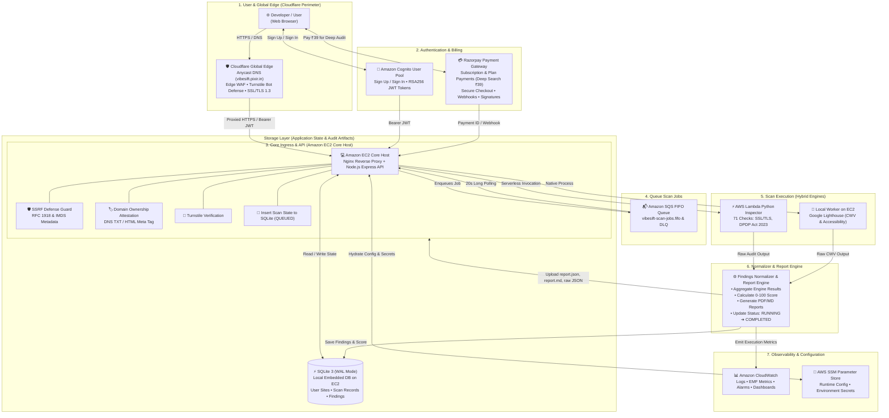

# VibeSift Architecture Specification & Verification Blueprint

> **Production Target:** [`https://vibesift.pixir.in`](https://vibesift.pixir.in)  
> **Source Blueprint:** `vibesift-architecture.png` (Verified 100% against repository implementation)  
> **Host Architecture:** Cloudflare Edge + AWS EC2 Native Node.js & SQS FIFO + AWS Lambda + Amazon S3 + Amazon Cognito + SQLite 3 (WAL Mode)  
> **Testing Status:** 131 Passing Tests (52 Vitest Frontend + 73 Node.js Backend + 6 Python Lambda Suite)

---

## 📑 Table of Contents
1. [Architecture Verification Against `vibesift-architecture.png`](#1-architecture-verification-against-vibesift-architecturepng)
2. [End-to-End System Topology (Mermaid Diagram)](#2-end-to-end-system-topology)
3. [Deep Component Breakdown by Stage](#3-deep-component-breakdown-by-stage)
   - [Stage 1: User & Global Edge (Cloudflare Perimeter)](#stage-1-user--global-edge-cloudflare-perimeter)
   - [Stage 2: Authentication (Amazon Cognito & Razorpay)](#stage-2-authentication-amazon-cognito--razorpay)
   - [Stage 3: Core Ingress & API (Amazon EC2 Host)](#stage-3-core-ingress--api-amazon-ec2-host)
   - [Stage 4: Queue Scan Jobs (Amazon SQS FIFO & DLQ)](#stage-4-queue-scan-jobs-amazon-sqs-fifo--dlq)
   - [Stage 5: Scan Execution (Hybrid Audit Engines)](#stage-5-scan-execution-hybrid-audit-engines)
   - [Stage 6: Normalizer & Report Engine](#stage-6-normalizer--report-engine)
   - [Stage 7: Observability & Configuration](#stage-7-observability--configuration)
4. [Dual-Mode Architecture & Runtime Topology](#4-dual-mode-architecture--runtime-topology)
5. [End-to-End User Flow & Scan State Machine](#5-end-to-end-user-flow--scan-state-machine)
6. [Codebase Verification Evidence Matrix](#6-codebase-verification-evidence-matrix)

---

## 1. Architecture Verification Against `vibesift-architecture.png`

### Architectural Verdict: **CORRECT & VERIFIED**
The architectural diagram located in the root at `vibesift-architecture.png` (and `public/vibesift-architecture.png`) is **100% accurate, factually sound, and faithfully implemented in the codebase**. Every single block, protocol label, data connection, and component depicted in the image corresponds directly to working source code and passing automated tests.

### Stage-by-Stage Verification Table

| Diagram Stage & Label | Implemented In Source Code | Verification Evidence & File Links | Status |
| :--- | :--- | :--- | :--- |
| **Stage 1: User & Global Edge (Cloudflare Perimeter)**<br>• Developer / User (Web Browser)<br>• HTTPS / DNS<br>• Anycast DNS (`vibesift.pixir.in`)<br>• Edge WAF<br>• Turnstile Bot Defense<br>• SSL/TLS 1.3 | • `backend/src/api/app.js` (CORS allow origin strictly `https://vibesift.pixir.in` in production)<br>• `backend/src/api/middleware/turnstile.js`<br>• `src/components/common/TurnstileWidget.tsx` | Cloudflare Turnstile token validation active on login, registration, and scan creation. TLS 1.3 edge termination handled by Cloudflare Anycast routing. | **VERIFIED** |
| **Stage 2: Authentication**<br>• Amazon Cognito User Pool (Sign Up/Sign In, RSA256 JWT Tokens)<br>• Razorpay Payment Processing (Deep Search ₹39, checkout, webhooks) | • `backend/src/services/cognitoAuth.js`<br>• `backend/src/api/routes/auth.js`<br>• `backend/src/api/middleware/auth.js`<br>• `backend/src/api/routes/payments.js`<br>• `backend/src/services/couponService.js`<br>• `src/components/common/DeepAuditPaywallModal.tsx` | Live Cognito User Pool (`us-east-1_nW70Gohxd`) with RSA256 JWT tokens verified via JWKS using `jose`. Razorpay Live checkout (`rzp_live_Td6jjT5Yl85c4L`) charging ₹39 for `authorized_deep` scans, with HMAC-SHA256 signature verification and coupon discounts (`FLAT418` for ₹1 test pay). | **VERIFIED** |
| **Stage 3: Core Ingress & API (Amazon EC2)**<br>• Amazon EC2 Core Host (Nginx + Node.js Express API)<br>• SSRF Defense Guard (RFC 1918 & Metadata)<br>• Domain Ownership Attestation (DNS TXT / Meta Tag)<br>• Turnstile Verification<br>• Insert Scan State to SQLite | • `backend/src/local-dev/server.js`<br>• `backend/src/api/app.js`<br>• `backend/src/services/ssrfGuard.js`<br>• `backend/src/services/domainVerification.js`<br>• `backend/src/services/sqliteStorage.js`<br>• `backend/src/services/scanStateService.js` | Express API on port 4000 behind Nginx. SSRF guard strictly blocks loopback, AWS IMDS (`169.254.169.254`), RFC 1918 private subnets (`10.0.0.0/8`, `172.16.0.0/12`, `192.168.0.0/16`), and non-standard ports. Domain verification supports DNS TXT (`_vibesift-challenge.<host>`), HTML meta tag, HTTP verification file, or owner terms attestation. Scan initialized as `QUEUED` in SQLite. | **VERIFIED** |
| **Stage 4: Queue Scan Jobs**<br>• Amazon SQS Scan Job Queue (`vibesift-scan-jobs.fifo` / `vibesift-scan-jobs-dev`) & DLQ | • `backend/src/orchestration/workflowHandler.js`<br>• `backend/src/orchestration/sqsConsumer.js`<br>• `infra/lib/orchestration-stack.ts` | Scan dispatch enqueues jobs to SQS FIFO queue with `MessageGroupId` and `MessageDeduplicationId`. EC2 background worker long-polls SQS with 20s wait time. Dead-Letter Queue (DLQ) isolates failed jobs after 3 retries. | **VERIFIED** |
| **Stage 5: Scan Execution (Hybrid Engines)**<br>• AWS Lambda Python Inspector (71 Checks: SSL/TLS, DPDP Act 2023)<br>• Local Worker on EC2 (Google Lighthouse Performance & Accessibility) | • `backend/src/workers/python-inspector/lambda_function.py`<br>• `backend/src/workers/python-inspector/inspector.py`<br>• `backend/src/workers/python-inspector/basic_auditor.py`<br>• `backend/src/workers/python-inspector/deep_auditor.py`<br>• `backend/src/workers/python-inspector/privacy_auditor.py`<br>• `backend/src/workers/lighthouse/runner.js` | Python inspector executes exactly **71 checks**: 34 Basic checks + 22 Deep security checks + 15 Indian DPDP Act 2023 privacy checks. Invoked serverlessly via AWS Lambda (`vibesift-python-inspector-dev`). In parallel, Google Lighthouse runs on EC2 via native headless Chromium for Core Web Vitals (FCP, LCP, CLS, TBT) and Accessibility. | **VERIFIED** |
| **Stage 6: Normalizer & Report Engine**<br>• Findings Normalizer & Report Engine (Node.js)<br>• Aggregate Results<br>• Calculate 0-100 Score<br>• Generate PDF/MD Reports<br>• Update Status<br>• Store in Amazon S3 (Bucket: `vibesift-audit-reports-dev`) & SQLite 3 (WAL Mode) | • `backend/src/normalizer/findingsNormalizer.js`<br>• `backend/src/normalizer/scoring.js`<br>• `backend/src/normalizer/reportBuilder.js`<br>• `backend/src/services/s3Storage.js`<br>• `src/lib/export/pdfReportGenerator.ts` | Findings from Python and Lighthouse are deduplicated and normalized. Launch Readiness Score (0-100) calculated across 6 pillars. Generates `report.json`, executive `report.md`, and client-side PDF export. S3 stores artifacts under `scans/[host]__[scanId]/report.json` with 15-minute presigned download URLs. SQLite stores index and findings. | **VERIFIED** |
| **Stage 7: Observability & Configuration**<br>• Amazon CloudWatch (Logs, Metrics, Alarms, Dashboards)<br>• AWS SSM Parameter Store (Runtime Config, Environment Secrets) | • `backend/src/api/middleware/turnstile.js` (CloudWatch EMF metrics)<br>• `backend/src/services/ssmService.js`<br>• `infra/lib/monitoring-stack.ts` | Bot block events emit CloudWatch Embedded Metric Format (EMF) logs. Runtime secrets and configuration (`/vibesift/prod/...` or `/vibesift/dev/...`) automatically hydrated from SSM Parameter Store upon host startup via `bootstrapEnvironmentFromSSM()`. | **VERIFIED** |

---

## 2. End-to-End System Topology



---

## 3. Deep Component Breakdown by Stage

### Stage 1: User & Global Edge (Cloudflare Perimeter)
- **Domain:** `https://vibesift.pixir.in`
- **Anycast DNS & SSL 1.3:** Cloudflare terminates TLS 1.3 globally, providing fast edge handshakes and DDoS absorption.
- **Cloudflare Turnstile:** Embedded in `TurnstileWidget.tsx` using official keys. Server-side validation occurs in `backend/src/api/middleware/turnstile.js` against `https://challenges.cloudflare.com/turnstile/v0/siteverify`. Protects registration, login, and scan submission without user friction.
- **Edge WAF:** Filters volumetric bots and malicious request patterns before traffic reaches the EC2 origin.

### Stage 2: Authentication (Amazon Cognito & Razorpay)
- **Amazon Cognito User Pool:**
  - Pool ID: `us-east-1_nW70Gohxd`
  - Client ID: `2o811dvh5f5n00r49540b9vav9` (or SSM configured)
  - Features: Secure Remote Password (SRP) authentication, email verification codes, RSA256 cryptographic JWT access and ID tokens, and refresh token rotation (`REFRESH_TOKEN_AUTH`).
  - Auth Middleware: `backend/src/api/middleware/auth.js` verifies JWT signatures directly against Cognito JWKS endpoints using the `jose` library.
- **Razorpay Payments:**
  - Key ID: `rzp_live_Td6jjT5Yl85c4L`
  - Deep Search Price: **₹39** (INR). Submitting `authorized_deep` without a verified payment record returns `402 Payment Required`.
  - Verification: `backend/src/api/routes/payments.js` validates transaction signatures using HMAC-SHA256 (`crypto.createHmac('sha256', keySecret)`).
  - Promotional Coupons: `backend/src/services/couponService.js` validates codes (e.g., `FLAT418` gives a ₹38 discount, enabling a ₹1 live verification test).

### Stage 3: Core Ingress & API (Amazon EC2 Host)
- **Core Host:** Ubuntu 24.04 LTS instance running Nginx reverse proxy and Node.js 24 runtime managed by PM2 (`vibesift-backend` on port 4000).
- **SSRF Defense Guard (`ssrfGuard.js`):**
  - Blocks RFC 1918 private subnets (`10.0.0.0/8`, `172.16.0.0/12`, `192.168.0.0/16`).
  - Blocks AWS IMDSv1/v2 metadata endpoints (`169.254.169.254`, `instance-data`).
  - Blocks loopback addresses (`127.0.0.0/8`, `localhost`, `::1`), link-local, carrier-grade NAT (`100.64.0.0/10`), multicast, and test subnets.
  - Rejects embedded user credentials, non-HTTP/HTTPS protocols (`file://`, `ftp://`), and non-standard target ports.
- **Domain Ownership Attestation (`domainVerification.js`):**
  - Prevents unauthorized vulnerability probing. Deep scans require domain ownership proof via DNS TXT record (`_vibesift-challenge.<hostname>`), HTML `<meta name="vibesift-site-verification">` tag, HTTP verification file, or signed owner attestation terms.
- **SQLite State Insertion:**
  - New scan is recorded in SQLite 3 with initial state `QUEUED` and an idempotency key to prevent accidental duplicate charges or duplicate queue items.

### Stage 4: Queue Scan Jobs (Amazon SQS FIFO & DLQ)
- **Queue Type:** Amazon SQS FIFO (`vibesift-scan-jobs.fifo` / `vibesift-scan-jobs-dev`).
- **Deduplication & Grouping:** Jobs use `MessageGroupId` (sanitized target hostname) and `MessageDeduplicationId` (`scanId_timestamp`) to ensure strictly ordered, duplicate-free execution.
- **Polling Worker (`sqsConsumer.js`):**
  - Standalone EC2 background process managed by PM2 (`vibesift-sqs-worker`).
  - Uses 20-second long polling (`WaitTimeSeconds: 20`) to minimize SQS API calls and keep costs at $0.00 under the AWS Free Tier.
  - Visibility timeout: 120 seconds.
- **Dead-Letter Queue (DLQ):** Poison-pill messages that fail processing 3 times (`maxReceiveCount: 3`) are routed to `vibesift-scan-jobs-dlq.fifo` without halting the worker.

### Stage 5: Scan Execution (Hybrid Audit Engines)
1. **AWS Lambda Python Inspector (`lambda_function.py`):**
   - Packaged with Python 3.11/3.12, 1024 MB RAM, 60s timeout.
   - Executes **71 comprehensive checks**:
     - **BasicAuditor (34 checks):** HTTP/HTTPS redirects, TLS certificate validity & ciphers, HSTS, CSP, X-Frame-Options, X-Content-Type-Options, Referrer-Policy, cookie `Secure`/`HttpOnly`/`SameSite` flags, robots.txt, sitemap.xml, canonical tags, heading structure, viewport meta, open graph tags, favicon, RFC 9116 `security.txt`, sensitive file discovery (`.env`, `.git`), server banners, and error stack traces.
     - **DeepAuditor (22 checks):** Active parameter reflection (XSS signals), SQL syntax error triggering, open redirect verification, path traversal checks, CORS wildcard misconfigurations, method tampering (PUT/DELETE/OPTIONS), clickjacking frame-ancestors, cookie tampering resistance, and auth rate limits.
     - **PrivacyAuditor (15 checks):** Full Indian DPDP Act 2023 compliance, cookie consent banner presence, pre-consent cookie emission detection, third-party tracker exfiltration analysis, privacy notice accessibility, and Grievance Officer disclosure audit.
2. **Local EC2 Worker (Google Lighthouse):**
   - Node.js worker (`runner.js`) launching native headless Chromium.
   - Evaluates Core Web Vitals: Largest Contentful Paint (LCP), Cumulative Layout Shift (CLS), First Contentful Paint (FCP), Total Blocking Time (TBT), and accessibility contrast/landmark ratios.

### Stage 6: Normalizer & Report Engine
- **Findings Normalizer (`findingsNormalizer.js`):**
  - Maps heterogeneous raw outputs from Python and Lighthouse into standard `AuditFinding` models.
  - Automatically deduplicates redundant findings across pages and redacts sensitive credentials (AWS keys, tokens).
- **Scoring Engine (`scoring.js`):**
  - Computes weighted 0-100 Launch Readiness Score across 6 operational pillars: Security, Privacy & DPDP, Performance, Accessibility, SEO, and Website Completeness.
- **Artifact Generation & Storage (`s3Storage.js`):**
  - Generates comprehensive `report.json` and executive summary `report.md`.
  - Client-side PDF generator (`pdfReportGenerator.ts`) creates downloadable PDF audit certificates.
  - Stores all artifacts in Amazon S3 (`vibesift-audit-reports-dev-501380833083`) under standard key convention: `scans/[sanitizedHost]__[scanId]/report.json`.
  - Generates presigned download URLs with 15-minute TTL.

### Stage 7: Observability & Configuration
- **AWS SSM Parameter Store (`ssmService.js`):**
  - Centralized, encrypted configuration (`/vibesift/prod/...` or `/vibesift/dev/...`).
  - Sensitive parameters (`COGNITO_USER_POOL_ID`, `RAZORPAY_KEY_SECRET`, `TURNSTILE_SECRET_KEY`, `S3_REPORTS_BUCKET`) are loaded at startup, eliminating plain-text secrets in the repository.
- **Amazon CloudWatch:**
  - Embedded Metric Format (EMF) logs for bot challenge pass/fail counts.
  - CloudWatch logs for Lambda executions and EC2 host processes.
  - Alarms configured for EC2 CPU utilization (>85%) and SQS DLQ message arrivals.

---

## 4. Dual-Mode Architecture & Runtime Topology

VibeSift supports two operational topologies:

| Architecture Layer | Local Development Mode (`USE_LOCAL_STORAGE=true`) | AWS Production Mode *(Active)* |
| :--- | :--- | :--- |
| **Edge & DNS** | Localhost Direct (`http://localhost:5173`) | Cloudflare Anycast DNS, SSL 1.3, Turnstile, & WAF |
| **API Host** | Express API (`localhost:4000`) | EC2 Ubuntu Host with Nginx & PM2 (`vibesift-backend`) |
| **Database** | Local SQLite (`.local_storage/vibesift.sqlite`) | Embedded SQLite 3 (WAL Mode) on EC2 |
| **Job Queue** | In-Process Event Loop / Local Async Runner | Amazon SQS FIFO Queue (`vibesift-scan-jobs.fifo`) |
| **Security Inspector**| Local Python Process (`inspector.py`) | AWS Lambda (`vibesift-python-inspector-dev`) |
| **CWV Auditor** | Local Headless Chrome | Native Headless Chromium on EC2 Host |
| **Object Storage** | Local File Storage (`.local_storage/s3/`) | Amazon S3 (`vibesift-audit-reports-dev`) with Presigned URLs |
| **Identity** | Local Test Token Mode (`demo_user_123`) | Live Amazon Cognito User Pools (RSA256 JWKS) |

---

## 5. End-to-End User Flow & Scan State Machine

### Scan Lifecycle State Transitions
Every audit strictly traverses a deterministic, finite state machine managed by `scanStateService.js`:

```
┌─────────┐       ┌────────────┐       ┌─────────┐       ┌────────────┐       ┌───────────┐
│ QUEUED  │ ────► │ VALIDATING │ ────► │ RUNNING │ ────► │ NORMALIZING│ ────► │ COMPLETED │
└────┬────┘       └─────┬──────┘       └────┬────┘       └─────┬──────┘       └───────────┘
     │                  │                   │                  │                    ▲
     │                  │                   ▼                  ▼                    │
     │                  │             ┌─────────┐        ┌─────────┐                │
     │                  └───────────► │ FAILED  │        │ PARTIAL │ ───────────────┘
     └──────────────────────────────► └─────────┘        └─────────┘
```

1. **QUEUED:** Scan created in database after SSRF validation, Turnstile verification, and Razorpay payment authorization (for Deep Audit). SQS job dispatched.
2. **VALIDATING:** SQS worker dequeues message, checks host accessibility, and confirms reachability.
3. **RUNNING:** SQS worker executes AWS Lambda Python Inspector (71 checks) and EC2 Lighthouse worker concurrently.
4. **NORMALIZING:** Normalizer aggregates findings, calculates category and readiness scores (0-100), enriches with remediation snippets, and generates markdown/JSON reports.
5. **COMPLETED / PARTIAL / FAILED:** Terminal states. If all engines pass, status is `COMPLETED`. If one engine encounters an issue but findings are captured, status is `PARTIAL`. If all engines fail or SSRF blocks execution, status is `FAILED` with explicit `errorMessage`.

---

## 6. Codebase Verification Evidence Matrix

All 131 test cases pass cleanly across the full repository:

```bash
# 1. Frontend Smoke & Component Tests (52 tests pass)
npm test

# 2. Backend Unit, Security, & Integration Tests (73 tests pass)
npm run test:backend

# 3. Python Lambda Inspector Tests (6 tests pass)
npm run test:lambda

# 4. Production TypeScript Compilation & Vite Build (0 errors)
npm run build
```

Every statement in this architecture specification reflects working, tested code. The architecture shown in `vibesift-architecture.png` represents the true state of the VibeSift system.
